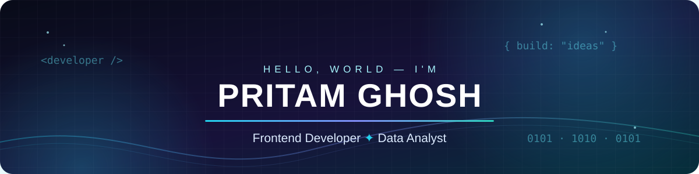
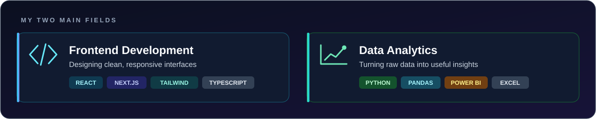

<div align="center">
  

  <br/><br/>

  <a href="https://devarthastudio.com"></a>
  <a href="https://github.com/pritammghosh?tab=repositories"></a>
  <a href="https://www.linkedin.com/in/pritam-ghosh-898046308/"></a>

  <br/><br/>

  
  
  
  
</div>

## `whoami` 👨‍💻

```python
class PritamGhosh:
    def __init__(self):
        self.role = "FRONTEND DEVELOPER & DATA ANALYST"
        self.main_fields = ["Frontend Development", "Data Analytics"]
        self.also = ["AI Automation", "Backend Basics"]
        self.company = "Devartha Studio"
        self.mission = "Make technology accessible to every business"
        self.open_to = ["Freelance", "Internships", "Collaboration"]

    def philosophy(self):
        return "Build useful things. Automate the boring stuff."
```

I'm a developer and the founder of [**Devartha Studio**](https://devarthastudio.com/), a design-led technology studio that helps businesses turn ideas into practical digital solutions.

My two main fields are **frontend development** and **data analytics**: I build clean, fast interfaces, and I turn raw data into dashboards and insights people can actually use.

<div align="center">
  
</div>

- 🌱 **Learning:** Advanced analytics, statistics, spatial data and AI engineering
- 🤖 **Exploring:** AI agents and workflow automation
- 🎯 **Mission:** Make technology easier to adopt for non-technical businesses

<div align="center"></div>

## ⚡ Tech Arsenal

<div align="center">

**FRONTEND & UI**


**LANGUAGES**


**DATA ANALYTICS & VISUALIZATION**


**BACKEND & DATABASES**


**TOOLS & WORKFLOW**


</div>

<div align="center"></div>

## 🚀 Things I've Built

<table>
<tr>
<td width="50%" valign="top">

### 🪙 Gold Inventory System

Inventory management designed for gold-related businesses.

- Track inventory and stock
- Organize product records
- Simplify business operations


</td>
<td width="50%" valign="top">

### 🧾 POS & Invoice Generator

A business tool combining point-of-sale operations with inventory tracking.

- Counter sales workflows
- Inventory management
- Invoice generation


</td>
</tr>
<tr>
<td width="50%" valign="top">

### 🎓 School CRM

An educational management platform for day-to-day school operations.

- Attendance and notices
- Library and study materials
- Exam results management


</td>
<td width="50%" valign="top">

### 🖥️ Window OS

An experimental web-based operating system that reimagines websites as system-level interfaces, focused on interaction, state and restraint.

- Desktop-style UI in the browser
- Built around interaction design


&nbsp;[**View repo →**](https://github.com/pritammghosh/Window-Operating-System)

</td>
</tr>
<tr>
<td width="50%" valign="top">

### 🐦 Panchi Encyclopedia

A community-focused platform concept for bird photographers.

- Photography community
- Bird discovery and documentation
- Nature-focused digital experiences


</td>
<td width="50%" valign="top">

### 📈 Analytics Dashboards

Data projects are on the way: business dashboards and data-driven reports.

- Cleaning and analysis with Python
- Interactive reports in Power BI & Excel


</td>
</tr>
</table>

<div align="center">

<a href="https://github.com/pritammghosh?tab=repositories">
  
</a>


</div>

## 🤝 Let's Build Something

Need a clean frontend, a dashboard, or someone to make sense of your data? I'm open to freelance work, internships and collaborations.

<div align="center">

<a href="https://devarthastudio.com"></a>
<a href="mailto:pritammmghosh@gmail.com"></a>
<a href="https://www.linkedin.com/in/pritam-ghosh-898046308/"></a>
<a href="https://www.instagram.com/devarthastudio/"></a>

<br/><br/>

*"The best technology isn't the most complicated. It's the technology that solves the right problem."*

<br/>


</div>
